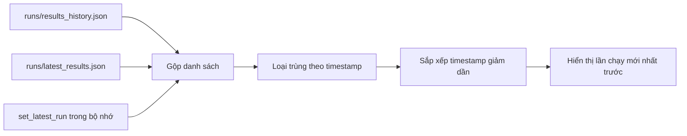
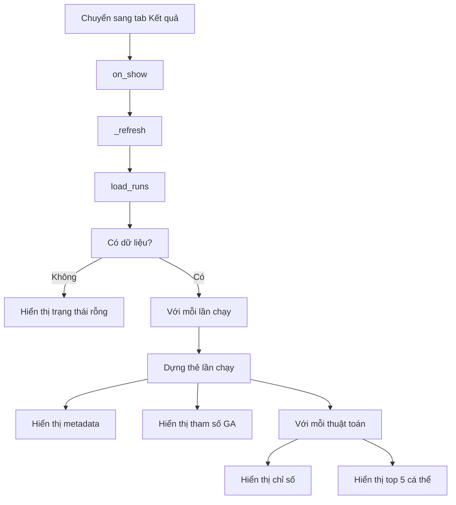

# Trang Kết quả (Results)

Tài liệu này mô tả chi tiết trang **Kết quả lan truyền**: nguồn dữ liệu, cách đọc lịch sử chạy, cấu trúc thẻ kết quả, ý nghĩa từng chỉ số và cách hiển thị top 5 cá thể.

- File giao diện: `src/im_research/gui/pages/results.py`
- File nguồn dữ liệu: `src/im_research/gui/core/results_store.py`
- File ghi dữ liệu: `src/im_research/gui/pages/experiments.py`
- Thư mục dữ liệu: `runs/`

---

## 1. Mục đích

Trang Kết quả dùng để:

1. Xem lại lịch sử các lần chạy thí nghiệm.
2. Xem kết quả của từng thuật toán trong mỗi lần chạy.
3. So sánh nhanh spread, thời gian, tỷ lệ lan truyền.
4. Xem top 5 cá thể tốt nhất của mỗi thuật toán.

Trang này **chỉ đọc dữ liệu đã lưu**, không trực tiếp chạy thuật toán.

---

## 2. Nguồn dữ liệu

Trang Kết quả lấy dữ liệu qua hàm:

```python
load_runs()
```

trong `src/im_research/gui/core/results_store.py`.

### 2.1. Thứ tự ưu tiên

`load_runs()` gom dữ liệu từ ba nguồn:

1. `runs/results_history.json` — mảng tất cả các lần chạy.
2. `runs/latest_results.json` — lần chạy mới nhất.
3. Bộ nhớ trong phiên hiện tại (`_LATEST_RUN`).

Sau đó:

- Loại bỏ dữ liệu trùng theo `timestamp`.
- Sắp xếp giảm dần theo `timestamp`.

Kết quả: **lần chạy mới nhất đứng đầu**.



### 2.2. Vì sao có bộ nhớ?

Nếu ghi file thất bại (ví dụ quyền ghi), kết quả vẫn được giữ trong bộ nhớ để người dùng xem ngay trong phiên hiện tại. Trang Kết quả vẫn hiển thị được lần chạy vừa xong.

### 2.3. Nút "Làm mới dữ liệu"

Nút này gọi `_refresh()`:

1. Xóa toàn bộ widget con.
2. Gọi lại `load_runs()`.
3. Dựng lại trang.
4. Cuộn về đầu.

Trang cũng tự gọi `on_show()` mỗi khi người dùng chuyển sang tab Kết quả.

---

## 3. Cấu trúc giao diện

### 3.1. Tiêu đề

Hiển thị:

- Tên trang: "Kết quả lan truyền (Influence Spread Results)".
- Phụ đề: mô tả ngắn và tổng số lần chạy.

Ví dụ:

```text
Lịch sử các lần chạy thí nghiệm · Mỗi thuật toán kèm top 5 cá thể tốt nhất · Tổng số lần chạy: 3
```

### 3.2. Thanh công cụ

- Ghi chú: dữ liệu đọc trực tiếp từ thư mục `runs/`.
- Nút **Làm mới dữ liệu**.

### 3.3. Trạng thái rỗng

Nếu chưa có dữ liệu:

- Hiển thị thẻ "Chưa có kết quả thực nghiệm".
- Có nút chuyển sang trang Thí nghiệm.

### 3.4. Danh sách lần chạy

Mỗi lần chạy là một thẻ lớn, thứ tự từ mới nhất đến cũ nhất.

Thẻ đầu tiên có nhãn **MỚI NHẤT**.

---

## 4. Thẻ của một lần chạy

### 4.1. Tiêu đề thẻ

Hiển thị:

```text
Lần chạy #1    MỚI NHẤT
```

Số thứ tự `#1` là vị trí trong danh sách đã sắp xếp, không phải mã lần chạy gốc.

### 4.2. Dòng metadata

Ví dụ:

```text
Karate Club · k=10 · IC (WC) · R=100 · 20261111_153000
```

Trong đó:

| Thành phần | Ý nghĩa |
|---|---|
| `Karate Club` | Bộ dữ liệu |
| `k=10` | Số hạt giống |
| `IC (WC)` | Mô hình lan truyền |
| `R=100` | Số lần Monte Carlo (`mc` hoặc `mc_val`) |
| `timestamp` | Thời điểm chạy |

### 4.3. Số thuật toán

Bên phải tiêu đề hiển thị:

```text
N thuật toán
```

với `N` là số phần tử trong `summary`.

Lưu ý: con số này **không tính baseline CELF**. Baseline nằm ở trường `baseline` và không hiển thị ở trang Kết quả.

### 4.4. Tham số GA

Nếu lần chạy có `params`, trang hiển thị:

```text
Tham số GA: N=50 · q=5 · Pc=0.9 · Pm=0.1 · E=2 · Tmax=100
```

Chỉ hiển thị các khóa có mặt trong `params`.

### 4.5. Danh sách thuật toán

Mỗi thuật toán là một thẻ con.

Thứ tự các thẻ con là thứ tự trong `summary`, đã được sắp xếp theo `mean_spread` giảm dần lúc lưu.

---

## 5. Thẻ con của một thuật toán

### 5.1. Dòng tiêu đề

Ví dụ:

```text
Baseline GA   Spread TB: 19.52 ± 2.31   Tỷ lệ: 57.41%   Thời gian: 0.632s   Cận trên: 24.10   k=10 hạt giống   Hạng: #1
```

Các thành phần:

| Thành phần | Nguồn dữ liệu | Ý nghĩa |
|---|---|---|
| Tên thuật toán | `algorithm` | Tên hiển thị |
| Spread TB | `mean_spread` ± `std_spread` | Spread trung bình và độ lệch chuẩn |
| Tỷ lệ | `ratio` | `final_spread / total_nodes` |
| Thời gian | `mean_time` | Thời gian chạy (giây) |
| Cận trên | `online_bound` | Chỉ CELF mới có |
| k hạt giống | `len(seeds)` | Số seed thực tế |
| Hạng | `rank` | Hạng trong lần chạy, tính lúc lưu |

### 5.2. Màu sắc

| Màu | Thuật toán |
|---|---|
| Đỏ | IGA |
| Xanh dương | CELF |
| Xanh lá | GA |
| Tím | Thuật toán khác |

### 5.3. Ý nghĩa các chỉ số

#### Spread TB

\[
mean\_spread = \frac{1}{mc} \sum_{i=1}^{mc} spread_i
\]

Đây là chỉ số quan trọng nhất để đánh giá chất lượng lan truyền.

#### Độ lệch chuẩn

\[
std\_spread = \sqrt{\frac{1}{mc} \sum_{i=1}^{mc} (spread_i - mean\_spread)^2}
\]

Cho biết mức biến động giữa các lần mô phỏng. Càng nhỏ càng ổn định.

#### Tỷ lệ lan truyền

\[
ratio = \frac{final\_spread}{total\_nodes}
\]

Trong đó `final_spread` là spread của lần mô phỏng đầu tiên. Vì vậy tỷ lệ này có thể khác `mean_spread / total_nodes`.

#### Thời gian

Thời gian chạy thuật toán và đánh giá, đơn vị giây.

#### Cận trên

Chỉ CELF có. Đây là cận trên lý thuyết cho spread tối ưu, không phải spread đạt được.

Nếu spread thực tế gần cận trên, nghiệm càng tốt.

#### Số hạt giống

Số phần tử trong `seeds`. Với CELF/GA thường bằng `k`. Nếu `k` lớn hơn số đỉnh, có thể bị giảm.

#### Hạng

Hạng được tính khi lưu:

1. Sắp xếp các thuật toán theo `mean_spread` giảm dần.
2. Gán `#1`, `#2`, ...

Đây là hạng **trong một lần chạy**, không phải hạng tổng hợp toàn cục.

---

## 6. Top 5 cá thể

### 6.1. Điều kiện hiển thị

- Nếu `individuals` rỗng: hiển thị "Không có dữ liệu cá thể."
- Nếu có: hiển thị tối đa 5 phần tử đầu tiên.

### 6.2. Tiêu đề

```text
TOP 5 CÁ THỂ (theo fitness tìm kiếm)
```

### 6.3. Mỗi dòng cá thể

Ví dụ:

```text
#1   Seeds: 0, 2, 33   Fitness: 20.43   Spread: 20.43
```

| Thành phần | Ý nghĩa |
|---|---|
| `#rank` | Hạng của cá thể |
| `Seeds` | Danh sách đỉnh |
| `Fitness` | Fitness dùng trong quá trình tìm kiếm |
| `Spread` | Spread khi đánh giá lại |

Nếu danh sách seed quá dài, hiển thị rút gọn và có tooltip chứa danh sách đầy đủ.

### 6.4. Phân biệt Fitness và Spread

- `fitness`: giá trị mục tiêu mà thuật toán dùng để chọn lọc.
- `spread`: giá trị lan truyền khi đánh giá lại tập seed đó.

Với GA C++, cá thể tốt nhất được đồng bộ `fitness` và `spread` theo kết quả cuối.

Với các cá thể khác, `fitness` có thể là giá trị ước lượng trong quá trình tìm kiếm, còn `spread` là giá trị kiểm chứng.

### 6.5. Cách chọn top 5

#### GA C++

- Trong quá trình chạy, C++ lưu mọi tập seed đã đánh giá vào một `map`.
- Nếu một tập seed xuất hiện nhiều lần, giữ fitness lớn nhất.
- Cuối cùng sắp xếp giảm dần theo fitness và lấy 5 tập đầu.

#### IGA / GA Python

- Dùng lịch sử đánh giá `evaluator.history`.
- Loại các cá thể không đúng kích thước `k`.
- Gom theo tập seed, giữ fitness lớn nhất.
- Sắp xếp giảm dần, lấy 5.
- Đánh giá lại spread cho các cá thể không phải best.

#### CELF

- Chỉ có một tập seed duy nhất.
- `individuals` có đúng 1 phần tử.

---

## 7. Luồng hiển thị



---

## 8. Các trường hợp đặc biệt

### 8.1. Thiếu trường dữ liệu

Trang dùng giá trị mặc định:

- `dataset`: `—`
- `k`: `—`
- `model`: `—`
- `mc`: `—`
- `mean_spread`: `0`
- `std_spread`: `0`
- `mean_time`: `0`
- `rank`: `-`

### 8.2. Lỗi đọc dữ liệu

Nếu `load_runs()` lỗi:

- Trang hiển thị cảnh báo màu cam.
- Danh sách rỗng.
- Vẫn hiển thị trạng thái rỗng.

### 8.3. Dữ liệu trùng timestamp

`load_runs()` loại trùng theo `timestamp`. Nếu hai lần chạy có cùng timestamp (cùng giây), chỉ một bản được giữ.

Đây là lý do timestamp dùng đến giây; chạy liên tiếp trong cùng một giây có thể bị gộp.

---

## 9. Quan hệ với trang Thí nghiệm và So sánh

| Trang | Vai trò |
|---|---|
| Thí nghiệm | Chạy thuật toán, tạo payload, ghi `runs/` |
| Kết quả | Đọc và hiển thị chi tiết từng lần chạy |
| So sánh | Đọc cùng dữ liệu, tính điểm tổng hợp, xếp hạng |

Trang Kết quả **không tính lại điểm tổng hợp** và **không xếp hạng toàn cục**. Việc đó thuộc trang So sánh.

---

## 10. Điểm cần lưu ý

1. Trang Kết quả chỉ hiển thị `summary`, không hiển thị `baseline`.
2. Hạng trên trang này là hạng trong từng lần chạy, không phải hạng tổng hợp.
3. `ratio` dùng spread của lần mô phỏng đầu, không dùng trung bình.
4. `online_bound` chỉ có với CELF.
5. Top 5 cá thể được sắp theo `fitness`, không phải theo `spread`.
6. Dữ liệu được sắp mới nhất trước, dựa trên `timestamp`.
