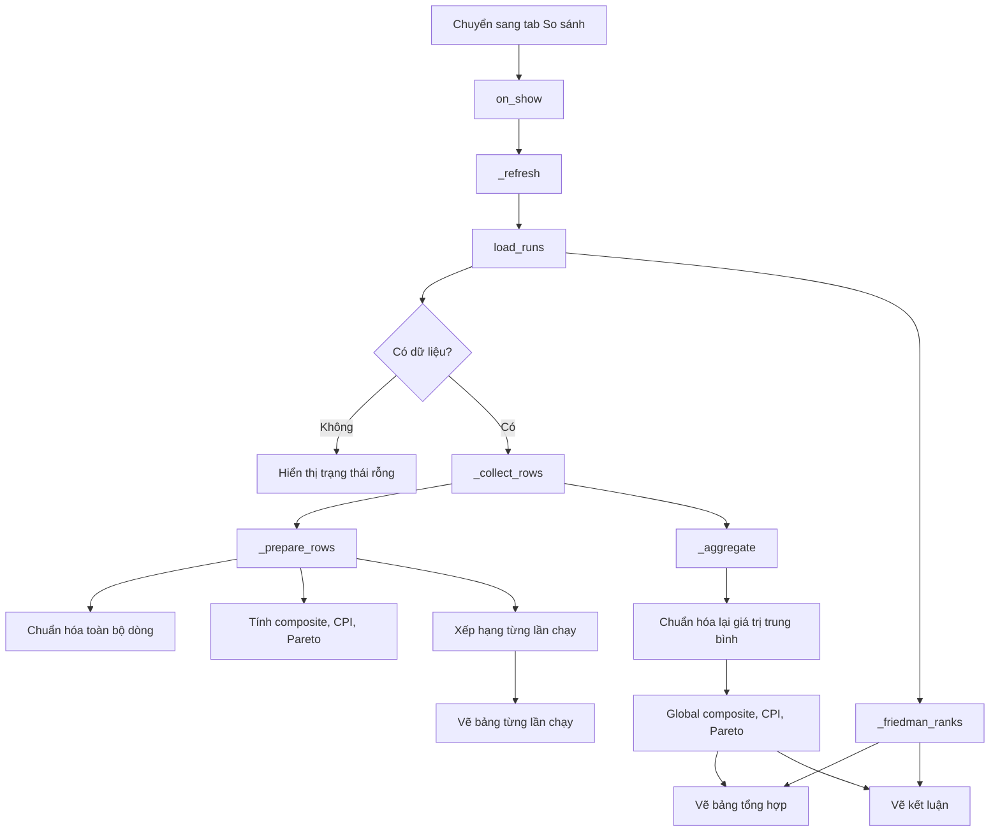

# Trang So sánh kết quả (Comparison)

Tài liệu này mô tả chi tiết trang **So sánh thuật toán**: nguồn dữ liệu, cách gom dữ liệu, các công thức chuẩn hóa, điểm tổng hợp, CPI, Pareto, Friedman rank, cách xếp hạng và cách đưa ra kết luận.

- File giao diện: `src/im_research/gui/pages/comparison.py`
- File nguồn dữ liệu: `src/im_research/gui/core/results_store.py`
- File ghi dữ liệu: `src/im_research/gui/pages/experiments.py`
- Thư mục dữ liệu: `runs/`

---

## 1. Mục đích

Trang So sánh dùng để:

1. So sánh nhiều thuật toán trong cùng một lần chạy.
2. So sánh thuật toán được chọn với baseline CELF.
3. Tổng hợp kết quả qua nhiều lần chạy.
4. Đánh giá theo nhiều tiêu chí:
   - Chất lượng lan truyền (Spread).
   - Tốc độ (Time).
   - Độ ổn định (Std).
   - Tốc độ hội tụ (Generations).
5. Xếp hạng theo:
   - Điểm tổng hợp Composite.
   - Pareto frontier.
   - Friedman rank.
   - CPI.
6. Đưa ra kết luận thực tế và học thuật.

Trang này **không chạy thuật toán**, chỉ đọc dữ liệu đã lưu.

---

## 2. Nguồn dữ liệu

Trang dùng `load_runs()` giống trang Kết quả:

1. Đọc `runs/results_history.json`.
2. Đọc `runs/latest_results.json`.
3. Đọc bộ nhớ phiên hiện tại.
4. Loại trùng theo `timestamp`.
5. Sắp xếp mới nhất trước.

Mỗi lần chạy có hai nhóm:

| Nhóm | Ý nghĩa |
|---|---|
| `summary` | Các thuật toán người dùng chọn |
| `baseline` | CELF tự động chạy khi chỉ chọn một thuật toán khác CELF |

---

## 3. Cách gom dữ liệu

Hàm `_collect_rows(runs)` tạo danh sách dòng để tính điểm.

Với mỗi lần chạy:

1. Lấy tất cả dòng trong `summary`.
2. Đánh dấu `_baseline = False`.
3. Gán `_run = index` để biết dòng thuộc lần chạy nào.
4. Nếu `summary` chỉ có đúng một thuật toán và thuật toán đó không phải CELF:
   - Thêm các dòng trong `baseline`.
   - Đánh dấu `_baseline = True`.

Điều kiện thêm baseline:

```python
if len(selected) == 1 and str(selected[0].get("code", "")).lower() != "celf":
    rows.extend(... baseline ...)
```

### 3.1. Ý nghĩa

- Nếu người dùng chạy GA hoặc IGA một mình, baseline CELF được đưa vào so sánh.
- Nếu người dùng chọn nhiều thuật toán, baseline không được thêm.
- Nếu người dùng chọn CELF, baseline không được thêm (tránh trùng).

---

## 4. Các chỉ số đầu vào

Mỗi dòng có các giá trị:

| Ký hiệu | Trường dữ liệu | Ý nghĩa |
|---|---|---|
| `S` | `mean_spread` | Spread trung bình |
| `T` | `mean_time` | Thời gian trung bình |
| `SD` | `std_spread` | Độ lệch chuẩn spread |
| `G` | `generations` | Số thế hệ/vòng |

Trong code:

```python
spreads = [mean_spread]
times = [mean_time]
stds = [std_spread]
generations = [max(1, generations)]
```

`generations` được đảm bảo tối thiểu `1` để tránh chia cho 0.

Lưu ý:

- Với GA: `generations` là số thế hệ đã chạy.
- Với CELF: `generations` là số vòng greedy, thường bằng `k`.
- Với IGA: `generations` là số thế hệ đã chạy.

---

## 5. Chuẩn hóa các chỉ số

Trang chuẩn hóa trên **toàn bộ các dòng của tất cả lần chạy**, không chuẩn hóa riêng từng lần.

### 5.1. Chuẩn hóa min-max

Hàm:

```python
def _min_max_normalize(values):
    lo = min(values)
    hi = max(values)
    if hi - lo < 1e-12:
        return [1.0 for _ in values]
    return [(value - lo) / (hi - lo) for value in values]
```

Công thức:

\[
x' = \frac{x - \min(x)}{\max(x) - \min(x)}
\]

Nếu tất cả giá trị bằng nhau, gán `1.0` cho mọi phần tử.

### 5.2. Chuẩn hóa Spread

\[
spread\_norm = minmax(S)
\]

Spread càng cao càng tốt.

### 5.3. Chuẩn hóa tốc độ

Không dùng min-max. Trang dùng tốc độ tương đối so với thuật toán nhanh nhất:

\[
speed\_norm = \frac{T_{min}}{T}
\]

Trong đó `T_min` là thời gian dương nhỏ nhất.

Quy ước:

- Nếu `T <= 0`: `speed_norm = 1.0`.
- Nếu không có thời gian dương: `speed_norm = 0.0`.

Ý nghĩa:

- Thuật toán nhanh nhất có `speed_norm = 1.0`.
- Thuật toán chậm gấp đôi có `speed_norm = 0.5`.

### 5.4. Chuẩn hóa độ lệch chuẩn

\[
std\_norm = minmax(SD)
\]

Std càng nhỏ càng tốt. Vì vậy khi tính điểm, dùng `1 - std_norm`.

### 5.5. Chuẩn hóa hội tụ

\[
conv\_norm = 1 - \frac{G}{\max(G)}
\]

Ý nghĩa:

- Thuật toán dùng ít thế hệ nhất có `conv_norm` gần `1`.
- Thuật toán dùng nhiều thế hệ nhất có `conv_norm = 0`.

---

## 6. Composite Score

Trọng số:

```python
WEIGHTS = {
    "spread": 0.45,
    "time": 0.30,
    "std": 0.15,
    "convergence": 0.10,
}
```

Công thức:

\[
composite = 0.45 \cdot spread\_norm
+ 0.30 \cdot speed\_norm
+ 0.15 \cdot (1 - std\_norm)
+ 0.10 \cdot conv\_norm
\]

Diễn giải:

| Thành phần | Trọng số | Hướng tốt |
|---|---|---|
| Spread | 45% | Cao |
| Tốc độ | 30% | Nhanh |
| Độ ổn định | 15% | Std thấp |
| Hội tụ | 10% | Ít thế hệ |

Giá trị `composite` nằm trong khoảng `0..1`.

Trên giao diện hiển thị dạng phần trăm:

```text
Composite = composite * 100%
```

---

## 7. CPI — Composite Performance Index

Công thức:

\[
CPI = \frac{S \cdot (1 - std\_norm)}{T \cdot G}
\]

Trong đó:

- `S`: spread trung bình.
- `std_norm`: độ lệch chuẩn đã chuẩn hóa.
- `T`: thời gian.
- `G`: số thế hệ/vòng.

Ý nghĩa:

- CPI cao khi spread cao, std thấp, thời gian thấp và số thế hệ ít.
- Đây là chỉ số hiệu năng trên mỗi đơn vị thời gian và công sức tìm kiếm.

Quy ước:

- Nếu `T <= 0` hoặc `G <= 0`: `CPI = 0`.

Lưu ý: CPI không được chuẩn hóa về `0..1`; giá trị có thể rất lớn hoặc rất nhỏ tùy đơn vị thời gian.

---

## 8. Pareto Frontier

Mục tiêu:

- Tối đa hóa `spread`.
- Tối thiểu hóa `time`.

Một dòng là **Pareto-optimal** nếu không tồn tại dòng khác tốt hơn hoặc bằng ở cả hai tiêu chí và tốt hơn thật sự ở ít nhất một tiêu chí.

Cài đặt:

```python
item["pareto"] = not any(
    other["spread"] >= item["spread"]
    and other["time"] <= item["time"]
    and (
        other["spread"] > item["spread"]
        or other["time"] < item["time"]
    )
    for other in prepared
    if other is not item
)
```

Ý nghĩa:

- `Yes`: thuật toán nằm trên biên Pareto.
- `No`: bị trội bởi ít nhất một thuật toán khác.

Pareto được tính:

- Trên từng dòng cho bảng theo lần chạy.
- Trên giá trị trung bình cho bảng tổng hợp toàn cục.

---

## 9. Xếp hạng hiển thị trong bảng từng lần chạy

Bảng của mỗi lần chạy hiển thị các cột:

```text
Hạng | Thuật toán | Spread | Time | Std | Gen | Composite | CPI | Pareto
```

### 9.1. Cách xếp hạng

Trong `_prepare_rows`, sau khi tính điểm cho **toàn bộ các dòng của mọi lần chạy**:

```python
prepared.sort(
    key=lambda item: (item["spread"], item["composite"]),
    reverse=True,
)
for rank, item in enumerate(prepared, start=1):
    item["rank"] = rank
```

Thứ tự ưu tiên:

1. `spread` giảm dần.
2. Nếu spread bằng nhau, `composite` giảm dần.

Sau đó `_build_run_cards` lọc các dòng theo từng lần chạy và hiển thị lại hạng đã tính.

Vì vậy cần hiểu chính xác:

- Hạng được tính **trên toàn bộ dòng của tất cả lần chạy**, không tính riêng trong từng lần.
- Vì vậy trong một thẻ lần chạy, các hạng có thể không liên tục (ví dụ `#1`, `#4`) nếu các thuật toán của lần chạy khác chen vào.
- Hạng này **ưu tiên spread**; composite chỉ dùng để phá hòa.
- Hạng này khác với `rank` được lưu trong `summary` lúc chạy thí nghiệm (hạng lưu là hạng trong riêng lần chạy đó).

### 9.2. Màu sắc

| Màu | Thuật toán |
|---|---|
| Đỏ | IGA |
| Xanh dương | CELF |
| Cam | GA |
| Tím | Khác |

### 9.3. Nhãn baseline

Nếu dòng là baseline:

```text
CELF (tham chiếu)
```

---

## 10. Tổng hợp toàn cục

Hàm `_aggregate(prepared)` gom các dòng theo `code` (hoặc tên nếu thiếu code).

Với mỗi thuật toán, tính trung bình:

| Chỉ số | Công thức |
|---|---|
| `mean_spread` | Trung bình spread |
| `mean_time` | Trung bình thời gian |
| `mean_std` | Trung bình std |
| `mean_generations` | Trung bình số thế hệ |
| `mean_composite` | Trung bình composite |
| `mean_cpi` | Trung bình CPI |
| `runs` | Số dòng/lần xuất hiện |
| `pareto_count` | Số lần nằm trên biên Pareto |

Sau đó trang **chuẩn hóa lại các giá trị trung bình** và tính:

- `global_composite`
- `global_cpi`
- `pareto` trên giá trị trung bình

### 10.1. Global Composite

\[
global\_composite = 0.45 \cdot spread\_norm
+ 0.30 \cdot speed\_norm
+ 0.15 \cdot (1 - std\_norm)
+ 0.10 \cdot conv\_norm
\]

Trong đó các `norm` được tính lại từ `mean_spread`, `mean_time`, `mean_std`, `mean_generations`.

### 10.2. Global CPI

\[
global\_CPI = \frac{mean\_spread \cdot (1 - std\_norm)}
{mean\_time \cdot mean\_generations}
\]

### 10.3. Bảng tổng hợp

Cột hiển thị:

```text
Thuật toán | Runs | Spread TB | Time TB | Std TB | Gen TB | Friedman Rank | Composite | CPI | Pareto
```

Thứ tự bảng:

```python
sorted(aggregated, key=lambda value: value["global_composite"], reverse=True)
```

Tức bảng tổng hợp được sắp theo **global composite giảm dần**.

Lưu ý: cột **Friedman Rank** độc lập với thứ tự composite. Một thuật toán có thể đứng đầu bảng composite nhưng có Friedman rank không tốt nhất.

---

## 11. Friedman Rank

Hàm `_friedman_ranks(runs)` tính thứ hạng thống kê qua từng lần chạy.

### 11.1. Cách tính

Với mỗi lần chạy:

1. Lấy `summary` và `baseline` (nếu có).
2. Sắp xếp các thuật toán theo `mean_spread` giảm dần.
3. Gán vị trí `1, 2, 3, ...`.
4. Ghi nhận vị trí cho từng thuật toán.

Sau khi qua tất cả các lần chạy:

\[
average\_rank = \frac{1}{r} \sum_{i=1}^{r} rank_i
\]

Trong đó `r` là số lần thuật toán xuất hiện.

Thuật toán có `average_rank` nhỏ hơn được xếp tốt hơn.

### 11.2. Ý nghĩa

- Friedman rank đo **tính ổn định tương đối** qua nhiều lần chạy.
- Một thuật toán có spread trung bình cao nhưng thỉnh thoảng tụt hạng sẽ có average rank cao hơn.
- Chỉ số này bổ sung cho composite: composite đo hiệu năng tổng hợp, Friedman đo thứ hạng qua các lần.

### 11.3. Lưu ý

Cài đặt hiện tại là phiên bản đơn giản hóa:

- Xếp hạng theo spread.
- Không xử lý hòa bằng average rank.
- Không kiểm định thống kê Friedman chính thức.

Vì vậy tên "Friedman Rank" mang ý nghĩa thứ hạng trung bình qua các lần chạy, không phải kiểm định Friedman đầy đủ.

---

## 12. Kết luận và kiến nghị

Phần cuối trang tạo câu kết luận dựa trên:

1. **Best Practical**:

```python
best_practical = max(aggregated, key=lambda item: item["global_composite"])
```

Là thuật toán có global composite cao nhất.

2. **Best Academic**:

```python
best_academic_key = friedman[0]["key"] if friedman else best_practical["key"]
```

Là thuật toán có average Friedman rank tốt nhất.

3. **Pareto names**:

Danh sách các thuật toán nằm trên biên Pareto tổng hợp.

Câu kết luận có dạng:

```text
Thực tế: <thuật toán> dung hòa tốt nhất giữa tốc độ và chất lượng (Composite <X>%).
Hàn lâm: <thuật toán> đạt thứ hạng thống kê tốt nhất (Friedman rank <Y> nếu có).
Biên Pareto: <danh sách>.
```

### 12.1. Diễn giải

| Mục | Tiêu chí | Dùng khi nào |
|---|---|---|
| Thực tế | Global Composite | Cần chọn thuật toán cân bằng chất lượng, tốc độ, ổn định |
| Hàn lâm | Friedman Rank | Cần lập luận thống kê qua nhiều lần chạy |
| Pareto | Spread vs Time | Cần thấy các lựa chọn đánh đổi |

---

## 13. Luồng xử lý của trang



---

## 14. Các tiêu chí đánh giá và xếp hạng cuối cùng

Tổng hợp lại, trang So sánh dùng bốn nhóm tiêu chí.

### 14.1. Chất lượng lan truyền

- Chỉ số: `mean_spread`.
- Hướng: càng cao càng tốt.
- Trọng số trong composite: 45%.

### 14.2. Tốc độ

- Chỉ số: `mean_time`.
- Hướng: càng thấp càng tốt.
- Trọng số trong composite: 30%.
- Được chuẩn hóa tương đối so với thuật toán nhanh nhất.

### 14.3. Độ ổn định

- Chỉ số: `std_spread`.
- Hướng: càng thấp càng tốt.
- Trọng số trong composite: 15%.

### 14.4. Hội tụ

- Chỉ số: `generations`.
- Hướng: càng ít càng tốt.
- Trọng số trong composite: 10%.

### 14.5. Các cách xếp hạng

| Cách xếp hạng | Tiêu chí chính | Phạm vi |
|---|---|---|
| Hạng hiển thị trong thẻ lần chạy | Spread, sau đó Composite | Toàn bộ dòng của mọi lần chạy |
| Bảng tổng hợp | Global Composite | Toàn bộ dữ liệu |
| Friedman Rank | Thứ hạng spread trung bình | Qua nhiều lần chạy |
| Pareto | Spread và Time | Trong từng lần và tổng hợp |
| Kết luận thực tế | Global Composite | Toàn bộ dữ liệu |
| Kết luận hàn lâm | Friedman Rank | Toàn bộ dữ liệu |

---

## 15. Các điểm cần lưu ý

1. **Chuẩn hóa toàn cục**: mọi dòng của mọi lần chạy được chuẩn hóa chung. Nếu các lần chạy dùng bộ dữ liệu khác nhau, việc so sánh composite có thể không còn ý nghĩa.
2. **Hạng hiển thị trong thẻ lần chạy được tính trên toàn bộ dòng của mọi lần chạy**, ưu tiên spread; composite chỉ phá hòa.
3. **Bảng tổng hợp ưu tiên global composite**, nên thứ tự có thể khác hạng hiển thị trong từng thẻ lần chạy.
4. **Friedman rank hiện là xếp hạng trung bình**, chưa phải kiểm định thống kê đầy đủ.
5. **CPI phụ thuộc đơn vị thời gian** và số thế hệ, nên chỉ nên so sánh tương đối.
6. **Pareto chỉ xét spread và time**, không xét std hay hội tụ.
7. **Baseline CELF chỉ xuất hiện** khi lần chạy chỉ chọn đúng một thuật toán khác CELF.
8. **Nếu tất cả giá trị bằng nhau**, min-max gán `1.0` cho mọi phần tử; khi đó composite chủ yếu do tốc độ và hội tụ quyết định.
9. **`generations` của CELF là số vòng greedy**, không phải số thế hệ tiến hóa. Điều này ảnh hưởng đến `conv_norm` và CPI khi so CELF với GA/IGA.
10. **Không có seed trên giao diện**: GA dùng seed ngẫu nhiên, CELF và IGA hiện dùng seed cố định. Vì vậy kết quả qua nhiều lần chạy có thể không hoàn toàn độc lập về mặt thống kê.
