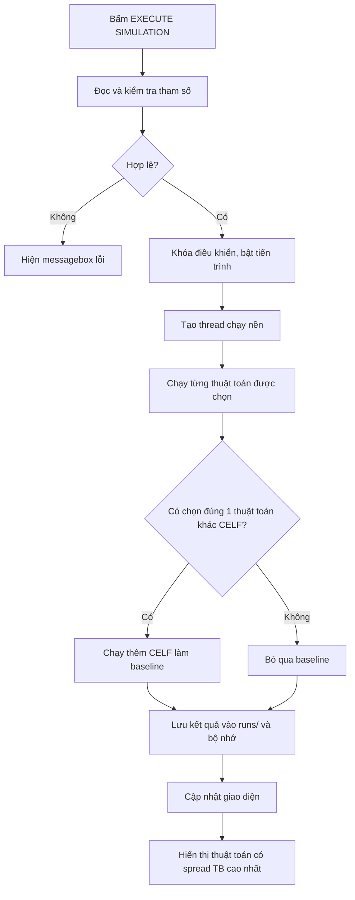

# Trang Thí nghiệm (Experiments)

Tài liệu này mô tả chi tiết trang **Thí nghiệm** trong ứng dụng: thành phần giao diện, luồng chạy, cách các thuật toán được gọi, ý nghĩa các tham số, cách tính kết quả và cách dữ liệu được lưu để hai trang **Kết quả** và **So sánh kết quả** đọc lại.

- File giao diện: `src/im_research/gui/pages/experiments.py`
- File xử lý thuật toán/mô phỏng: `src/im_research/gui/components/diffusion_simulator.py`
- File lưu trữ dùng chung: `src/im_research/gui/core/results_store.py`
- Thư mục dữ liệu đầu ra: `runs/`

---

## 1. Mục đích của trang

Trang Thí nghiệm là nơi người dùng:

1. Chọn bộ dữ liệu đồ thị.
2. Chọn số hạt giống `k` và số lần Monte Carlo `mc`.
3. Nhập tham số cho GA.
4. Chọn một hoặc nhiều thuật toán: `CELF`, `Baseline GA`, `Improved GA`.
5. Chạy mô phỏng lan truyền.
6. Xem trực quan quá trình lan truyền của cá thể tốt nhất.
7. Xem nhanh các chỉ số của từng thuật toán vừa chạy.
8. Tự động lưu kết quả vào `runs/` để các trang sau đọc lại.

---

## 2. Thành phần giao diện

Trang được chia thành 3 khu vực chính.

### 2.1. Khu vực 1 — Cấu hình và chọn thuật toán

Các trường cấu hình:

| Trường | Ý nghĩa | Mặc định |
|---|---|---|
| Bộ dữ liệu | Chọn đồ thị đầu vào | Karate Club |
| Mô hình lan truyền | Cố định `IC (WC)` | IC (WC) |
| `k` | Số hạt giống cần chọn | 10 |
| Số lần Monte Carlo | Số lần mô phỏng lặp để tính spread trung bình | 100 |

Bộ dữ liệu hỗ trợ:

- Karate Club
- Dolphins
- ego-Facebook
- NetHEPT
- Email-Enron

Mô hình lan truyền được cố định là **Independent Cascade with Weighted Cascade (IC-WC)**:

\[
p(u \rightarrow v) = \frac{1}{\deg(v)}
\]

Tức xác suất lây nhiễm từ `u` sang `v` tỉ lệ nghịch với bậc của `v`.

### 2.2. Tham số GA

Sáu tham số GA được nhập trực tiếp trên giao diện:

| Tham số | Ý nghĩa | Mặc định | Ràng buộc |
|---|---|---|---|
| `N` | Kích thước quần thể | 50 | `N >= 2` |
| `q` | Kích thước tournament selection | 5 | `1 <= q <= N` |
| `Pc` | Xác suất lai ghép | 0.90 | `0 <= Pc <= 1` |
| `Pm` | Xác suất đột biến | 0.10 | `0 <= Pm <= 1` |
| `E` | Số cá thể elite giữ lại | 2 | `0 <= E < N` |
| `Tmax` | Số thế hệ tối đa | 100 | `Tmax >= 1` |

Các tham số này được đóng gói thành:

```python
ga_params = {
    "N": n_pop,
    "q": q_tour,
    "Pc": pc,
    "Pm": pm,
    "E": elite,
    "Tmax": tmax,
}
```

và truyền xuống các backend thuật toán.

Lưu ý: **không còn ô nhập seed** trên giao diện. Seed của GA được backend tự sinh ngẫu nhiên (xem mục 4.2).

### 2.3. Chọn thuật toán

Ba lựa chọn:

- `Greedy / CELF`
- `Baseline GA`
- `Improved GA`

Người dùng có thể chọn một hoặc nhiều thuật toán. Mặc định chọn `Baseline GA`.

Nút **EXECUTE SIMULATION** khởi chạy mô phỏng.

Thanh tiến trình hiển thị:

- Phần trăm tiến độ.
- Trạng thái hiện tại.
- Thuật toán đang chạy.

### 2.4. Khu vực 2 — Mô phỏng lan truyền trên đồ thị

Khu vực này hiển thị đồ thị 2D và quá trình lan truyền theo từng bước.

Thành phần:

- Badge thông tin đồ thị: tên, số đỉnh, số cạnh.
- Nếu đồ thị bị rút gọn để hiển thị: hiển thị thêm số đỉnh gốc.
- Nếu dùng C++ core: hiển thị ghi chú GA C++ chạy trên toàn bộ đồ thị.
- Canvas vẽ đồ thị.
- Nút điều khiển: về đầu, phát, tạm dừng, bước tiếp, đặt lại.
- Thanh tốc độ phát.
- Nhãn bước hiện tại.

Màu sắc:

| Màu | Ý nghĩa |
|---|---|
| Vàng | Hạt giống |
| Xanh lá | Đỉnh mới bị kích hoạt ở bước hiện tại |
| Xanh dương | Đỉnh đã kích hoạt trước đó |
| Xám | Đỉnh chưa kích hoạt |

Cạnh mới lan truyền ở bước hiện tại được tô màu xanh lá.

### 2.5. Khu vực 3 — Kết quả mô phỏng

Khu vực này hiển thị kết quả của thuật toán đang được chọn trong menu **Hiển thị**.

Các ô thống kê:

| Ô | Nội dung |
|---|---|
| Thuật toán | Tên thuật toán |
| Bộ dữ liệu | Tên bộ dữ liệu |
| Hạt giống | Số lượng hạt giống; rê chuột để xem danh sách ID |
| Lan truyền cuối | `final_spread / total_nodes` |
| Tỷ lệ lan truyền | Phần trăm lan truyền |
| Thời gian thực thi | Thời gian chạy thuật toán |

Sau khi chạy xong, trang tự chọn thuật toán có `mean_spread` cao nhất để hiển thị.

---

## 3. Luồng xử lý khi bấm EXECUTE SIMULATION

Luồng tổng quát:



### 3.1. Kiểm tra tham số

Trang kiểm tra:

- `k > 0`, `mc > 0`.
- `N >= 2`.
- `1 <= q <= N`.
- `0 <= E < N`.
- `Tmax >= 1`.
- `0 <= Pc <= 1`.
- `0 <= Pm <= 1`.
- Đã có đồ thị hay chưa.
- Nếu `k > số đỉnh` thì tự giảm `k` về số đỉnh.

Nếu sai, hiển thị hộp thoại lỗi và không chạy.

### 3.2. Chạy nền

Mô phỏng chạy trong một `threading.Thread` để không treo giao diện:

```python
worker = threading.Thread(
    target=self._run_worker,
    args=(self._graph, dict(self._meta), self.ds_var.get(),
          self.model_var.get(), k, mc, selected, ga_params),
    daemon=True,
)
```

Trong lúc chạy:

- Khóa dropdown, ô nhập, checkbox và nút chạy.
- Cập nhật thanh tiến trình.
- Giao diện chỉ được cập nhật qua `self.after(0, ...)`.

### 3.3. Baseline CELF tự động

Nếu người dùng chọn **đúng một thuật toán** và thuật toán đó **không phải CELF**, hệ thống tự chạy thêm CELF làm mốc tham chiếu:

```python
baseline_codes = (
    ["celf"]
    if len(selected) == 1 and selected[0] != "celf"
    else []
)
```

Kết quả CELF baseline:

- Không được đưa vào `outcomes`.
- Được lưu riêng trong `baseline`.
- Được trang So sánh hiển thị với nhãn `(tham chiếu)`.

Nếu chọn từ 2 thuật toán trở lên, không tự chạy baseline.

### 3.4. Định tuyến thuật toán

| Trường hợp | Hàm được gọi | Đồ thị chạy |
|---|---|---|
| `ga` và C++ core khả dụng | `run_cpp_ga_on_graph` | Toàn bộ đồ thị gốc |
| `celf` và C++ core khả dụng | `run_celf_on_graph` | Toàn bộ đồ thị gốc |
| Các trường hợp còn lại (IGA, fallback) | `run_simulation_on_graph` | Đồ thị preview (tối đa 220 đỉnh) |

Điểm cần lưu ý:

- GA C++ và CELF C++ chạy trên **toàn bộ đồ thị gốc**.
- IGA hiện chạy bằng Python trên **đồ thị preview đã rút gọn tối đa 220 đỉnh**.
- Vì vậy, khi so sánh IGA với GA/CELF trên bộ dữ liệu lớn, cần hiểu rằng IGA đang tối ưu trên đồ thị nhỏ hơn.

### 3.5. Tiến trình

Mỗi thuật toán nhận một callback `progress(phase)` với `phase` trong khoảng `0..1`.

Tiến trình toàn cục được chia đều theo số thuật toán:

\[
\text{progress} = \frac{\text{index}}{\text{total}} + \frac{\text{phase}}{\text{total}}
\]

Ví dụ: chạy 2 thuật toán, thuật toán thứ nhất ở phase `0.5` thì tiến trình tổng là `0.25`.

### 3.6. Xử lý lỗi

- Lỗi của thuật toán được chọn: ghi vào `errors`, không làm hỏng các thuật toán khác.
- Lỗi của baseline CELF: bị bỏ qua, không hiển thị.
- Nếu tất cả thuật toán đều lỗi: hiển thị `messagebox.showerror`.
- Nếu lưu file lỗi: vẫn hiển thị kết quả, nhưng có cảnh báo riêng.

### 3.7. Cập nhật kết quả

Sau khi chạy:

1. Gán `self._outcomes = outcomes`.
2. Tạo menu chọn thuật toán.
3. Chọn thuật toán có `mean_spread` lớn nhất.
4. Hiển thị các ô thống kê.
5. Nạp timeline của thuật toán đó vào canvas.
6. Hiển thị trạng thái hoàn tất.

---

## 4. Cách các thuật toán hoạt động

### 4.1. CELF — Greedy với Lazy Forward

File: `src/im_research/algorithms/greedy/celf.py`

CELF là thuật toán greedy xấp xỉ cho bài toán Influence Maximization.

Ý tưởng:

1. Bắt đầu với tập hạt giống rỗng.
2. Ở mỗi vòng, chọn đỉnh có **marginal gain** lớn nhất:

\[
\Delta_s = R(A \cup \{s\}) - R(A)
\]

3. Thêm đỉnh đó vào tập hạt giống.
4. Lặp đến khi đủ ngân sách `k` (chi phí đơn vị).

Để tránh đánh giá lại mọi đỉnh ở mỗi vòng, CELF dùng **lazy forward**:

- Khởi tạo marginal gain của từng đỉnh so với tập rỗng.
- Đưa tất cả vào max-heap.
- Lấy đỉnh có gain lớn nhất ra.
- Nếu gain của đỉnh đó đã được tính ở vòng hiện tại (`flag == current_step`) thì chọn luôn.
- Nếu gain cũ (stale), tính lại marginal gain rồi đẩy lại vào heap.

Cài đặt chạy hai biến thể:

| Biến thể | Khóa trong heap | Ý nghĩa |
|---|---|---|
| `UC` | `delta_s` | Unit-Cost, tối đa hóa spread với chi phí đơn vị |
| `CB` | `delta_s / c(s)` | Cost-Benefit, tối đa hóa spread trên mỗi đơn vị chi phí |

Sau khi chạy cả hai, chọn biến thể có spread cuối lớn hơn.

#### Online upper bound

CELF còn tính cận trên trực tuyến cho nghiệm tối ưu:

\[
OPT \leq R(A) + \sum_{i=1}^{k-1} \Delta_{s_i} + \lambda \Delta_{s_k}
\]

Trong đó:

- Các đỉnh còn lại được sắp giảm dần theo `delta_s / c(s)`.
- `k` là điểm cắt sao cho tổng chi phí trước điểm cắt không vượt ngân sách.
- `lambda` là phần ngân sách còn lại chia cho chi phí của đỉnh tại điểm cắt.

Giá trị này được lưu trong `result.metadata["online_bound"]` và hiển thị ở trang Kết quả/So sánh.

#### Đặc điểm trong ứng dụng

- Chạy bằng evaluator C++ trên toàn bộ đồ thị (nếu C++ core khả dụng).
- Seed cố định `42` để CELF deterministic.
- Trả về đúng **một** tập hạt giống.
- Trường `individuals` chỉ có 1 phần tử.
- Trường `generations` bằng số vòng greedy (thường bằng `k`).

### 4.2. Baseline GA (C++)

File C++: `cpp_core/src/ga.cpp`

File gọi từ Python: `run_cpp_ga_on_graph` trong `diffusion_simulator.py`.

#### Biểu diễn cá thể

Mỗi cá thể là một tập `k` đỉnh:

```text
individual = [s1, s2, ..., sk]
```

Các đỉnh được sắp xếp tăng dần và không trùng nhau.

#### Khởi tạo quần thể

- Tạo `N` cá thể ngẫu nhiên.
- Mỗi cá thể chọn `k` đỉnh không lặp.
- Nếu `k >= n` thì lấy toàn bộ đỉnh.

#### Hàm fitness

Fitness là spread trung bình trên `mc` lần mô phỏng Monte Carlo IC-WC:

\[
fitness(S) = \frac{1}{mc} \sum_{i=1}^{mc} |R_i(S)|
\]

Trong C++, evaluator dùng chung một seed cơ sở và sinh seed cho từng lần mô phỏng.

#### Chọn lọc

Tournament selection:

1. Chọn ngẫu nhiên `q` cá thể.
2. Giữ cá thể có fitness cao nhất.

#### Lai ghép

Lai ghép theo tập:

1. Hợp hai tập seed của cha và mẹ.
2. Nếu hợp nhỏ hơn `k`, bổ sung đỉnh ngẫu nhiên.
3. Sinh hai con bằng cách lấy ngẫu nhiên `k` đỉnh từ hợp.

#### Đột biến

Với từng gene (từng vị trí seed):

- Với xác suất `Pm`, thay đỉnh hiện tại bằng một đỉnh ngẫu nhiên chưa có trong cá thể.
- Sắp xếp lại tập seed.

#### Elitism

Mỗi thế hệ giữ lại `E` cá thể tốt nhất không thay đổi.

#### Vòng lặp

Chạy tối đa `Tmax` thế hệ. Dừng sớm nếu đạt giới hạn đánh giá (nếu có).

Sau khi kết thúc:

- Đánh giá lại cá thể tốt nhất.
- Ghi lại top 5 tập seed tốt nhất từng được đánh giá.
- Trả về best seeds, fitness, lịch sử hội tụ, số thế hệ, số đánh giá.

#### Seed

- `GAConfig.seed` mặc định là `-1`.
- Nếu `seed < 0`, C++ dùng `std::random_device` để sinh seed ngẫu nhiên.
- Python cũng xử lý `seed < 0` bằng `time.time_ns()` trước khi truyền xuống C++.
- Vì vậy mỗi lần chạy GA sẽ có seed khác nhau.
- Kết quả GA có thể vẫn giống nhau ở tập seed tốt nhất nếu đồ thị nhỏ và GA hội tụ về cùng vùng tối ưu; các chỉ số như thời gian, spread, top 5 cá thể vẫn có thể khác.

### 4.3. Improved GA (IGA)

File: `src/im_research/algorithms/evolutionary/iga.py`

IGA là biến thể cải tiến của GA, gồm ba cơ chế chính.

#### 1. Khởi tạo có định hướng bậc

- 70% quần thể: chọn seed theo phân phối xác suất tỉ lệ với bậc đỉnh (có Laplace smoothing).
- 30% quần thể: chọn ngẫu nhiên đều để giữ khả năng khám phá.

#### 2. Đột biến thích nghi theo độ đa dạng

- Tính độ đa dạng Jaccard trung bình của quần thể.
- Nếu độ đa dạng thấp hơn ngưỡng `0.30`, tăng dần `Pm` từ `Pm` cơ sở lên tối đa `0.35`.
- Mục tiêu: thoát khỏi hội tụ sớm.

#### 3. Đột biến có hướng dẫn bậc

- Khi thay một seed, 70% khả năng chọn từ nhóm đỉnh có bậc cao.
- 30% còn lại chọn ngẫu nhiên để duy trì đa dạng.

#### Các toán tử khác

- Tournament selection giống GA.
- Lai ghép theo tập: lấy ngẫu nhiên `k` đỉnh từ hợp hai cha mẹ.
- Elitism giữ `E` cá thể tốt nhất.
- Đánh giá hàng loạt bằng Python.

#### Đặc điểm trong ứng dụng

- IGA chạy qua `run_simulation_on_graph`.
- Đồ thị đầu vào là đồ thị preview tối đa 220 đỉnh.
- Seed hiện được đặt mặc định `42`, nên IGA deterministic trong cấu hình hiện tại.
- Trả về top 5 cá thể dựa trên lịch sử đánh giá.

---

## 5. Cách tính các chỉ số

### 5.1. Timeline lan truyền

Với một tập seed, mô phỏng IC-WC trả về danh sách các bước:

```text
timeline = [ [seed1, seed2], [node mới], [node mới], ... ]
```

Mỗi phần tử là các đỉnh mới bị kích hoạt ở bước đó.

### 5.2. Spread

Với mỗi lần mô phỏng:

\[
spread = \sum_{step} |step|
\]

Tức tổng số đỉnh bị kích hoạt trong lần mô phỏng đó.

### 5.3. Spread trung bình

\[
mean\_spread = \frac{1}{mc} \sum_{i=1}^{mc} spread_i
\]

### 5.4. Độ lệch chuẩn

\[
std\_spread = \sqrt{\frac{1}{mc} \sum_{i=1}^{mc} (spread_i - mean\_spread)^2}
\]

### 5.5. Tỷ lệ lan truyền

Trang Thí nghiệm hiển thị:

\[
ratio = \frac{final\_spread}{total\_nodes}
\]

Trong đó `final_spread` là spread của lần mô phỏng đầu tiên (hoặc giá trị đánh giá cuối cùng tùy backend).

Ngoài ra dữ liệu còn lưu:

\[
mean\_ratio = \frac{mean\_spread}{total\_nodes}
\]

### 5.6. Thời gian thực thi

Thời gian được đo bằng `time.perf_counter()` quanh phần chạy thuật toán và đánh giá.

Với GA/CELF C++, thời gian chủ yếu là thời gian tìm kiếm và đánh giá Monte Carlo trong C++.

### 5.7. Online bound

Chỉ CELF có giá trị này. Đây là cận trên cho spread tối ưu, không phải spread thực tế của thuật toán.

---

## 6. Cách dữ liệu được lưu

Hàm `_save_results` trong `experiments.py` thực hiện:

1. Sắp xếp các thuật toán theo `mean_spread` giảm dần.
2. Gán hạng `#1`, `#2`, ... cho từng thuật toán.
3. Tạo payload JSON.
4. Lưu vào bộ nhớ qua `set_latest_run(payload)`.
5. Ghi file.

### 6.1. Các file được ghi

| File | Nội dung |
|---|---|
| `runs/latest_results.json` | Lần chạy mới nhất |
| `runs/EXP_<timestamp>/summary.json` | Bản sao của lần chạy đó |
| `runs/results_history.json` | Mảng tất cả các lần chạy |

`timestamp` có dạng `YYYYMMDD_HHMMSS`.

### 6.2. Cấu trúc payload

```json
{
  "dataset": "Karate Club",
  "k": 10,
  "model": "IC (WC)",
  "mc": 100,
  "mc_val": 100,
  "runs": 1,
  "timestamp": "20261111_153000",
  "params": { "N": 50, "q": 5, "Pc": 0.9, "Pm": 0.1, "E": 2, "Tmax": 100 },
  "summary": [ ... ],
  "baseline": [ ... ],
  "details": { ... }
}
```

### 6.3. Mỗi phần tử trong `summary`

| Trường | Ý nghĩa |
|---|---|
| `algorithm` | Tên hiển thị |
| `code` | Mã thuật toán: `celf`, `ga`, `iga` |
| `algorithm_name` | Tên thuật toán từ backend |
| `model` | Mô hình lan truyền |
| `mean_spread` | Spread trung bình |
| `std_spread` | Độ lệch chuẩn spread |
| `final_spread` | Spread của lần mô phỏng đầu |
| `best_spread` | Spread lớn nhất trong các lần mô phỏng |
| `mean_ratio` | `mean_spread / total_nodes` |
| `ratio` | `final_spread / total_nodes` |
| `total_nodes` | Số đỉnh |
| `mean_time` | Thời gian chạy |
| `rank` | Hạng trong lần chạy |
| `seeds` | Danh sách seed tốt nhất |
| `params` | Tham số GA |
| `individuals` | Top 5 cá thể |
| `online_bound` | Cận trên CELF (nếu có) |
| `seed` | Seed đã dùng |
| `generations` | Số thế hệ/vòng |

### 6.4. Baseline

- `summary`: các thuật toán người dùng chọn.
- `baseline`: CELF tự động chạy nếu chỉ chọn đúng một thuật toán khác CELF.
- Trang Kết quả chỉ hiển thị `summary`.
- Trang So sánh hiển thị cả `summary` và `baseline`.

### 6.5. Top 5 cá thể

Mỗi cá thể gồm:

```json
{
  "rank": 1,
  "seeds": [0, 2, 33],
  "fitness": 20.43,
  "spread": 20.43
}
```

- `fitness`: giá trị fitness dùng trong quá trình tìm kiếm.
- `spread`: giá trị spread khi đánh giá lại.
- Với GA C++, `fitness` của cá thể tốt nhất được đồng bộ với kết quả cuối.
- Với CELF, chỉ có một cá thể.

---

## 7. Đồ thị preview và đồ thị đầy đủ

### 7.1. Tải dữ liệu

`load_graph_for_sim` thực hiện:

1. Đọc dữ liệu từ `data/raw/` nếu có.
2. Nếu không có, sinh đồ thị tổng hợp.
3. Bỏ self-loop.
4. Lấy thành phần liên thông lớn nhất.
5. Nếu số đỉnh lớn hơn 220, lấy lõi BFS từ đỉnh bậc cao nhất.
6. Đánh số lại đỉnh liên tục từ `0`.

`meta` lưu:

- `name`
- `n`, `m`
- `full_n`, `full_m`
- `reduced`: đồ thị preview có nhỏ hơn đồ thị gốc không

### 7.2. Hệ quả

- Canvas và animation dùng đồ thị preview tối đa 220 đỉnh.
- GA C++ và CELF C++ tải lại đồ thị gốc đầy đủ từ `load_networkx_graph(dataset)`.
- Vì vậy đỉnh có ID lớn hơn 219 có thể xuất hiện trong kết quả GA/CELF nhưng không được vẽ trên canvas preview.
- IGA chạy trên đồ thị preview, nên seed của IGA luôn nằm trong miền preview.

---

## 8. Các điểm cần lưu ý

1. **Không còn nhập seed trên giao diện.** GA tự sinh seed ngẫu nhiên; CELF và IGA hiện dùng seed cố định.
2. **GA/CELF chạy full graph**, IGA chạy preview graph. Khi so sánh trên đồ thị lớn cần nêu rõ điều này.
3. **Kết quả GA có thể trùng seed tốt nhất** giữa các lần chạy do hội tụ, nhưng thời gian, spread và top 5 cá thể thường khác.
4. **Baseline CELF chỉ tự chạy** khi chọn đúng một thuật toán không phải CELF.
5. **`ratio` và `mean_ratio` khác nhau**: một cái dùng lần mô phỏng đầu, một cái dùng trung bình.
6. **`online_bound` không phải kết quả thực tế**, chỉ là cận trên lý thuyết.
7. **Trang Kết quả không hiển thị baseline**; baseline chỉ xuất hiện ở trang So sánh.
